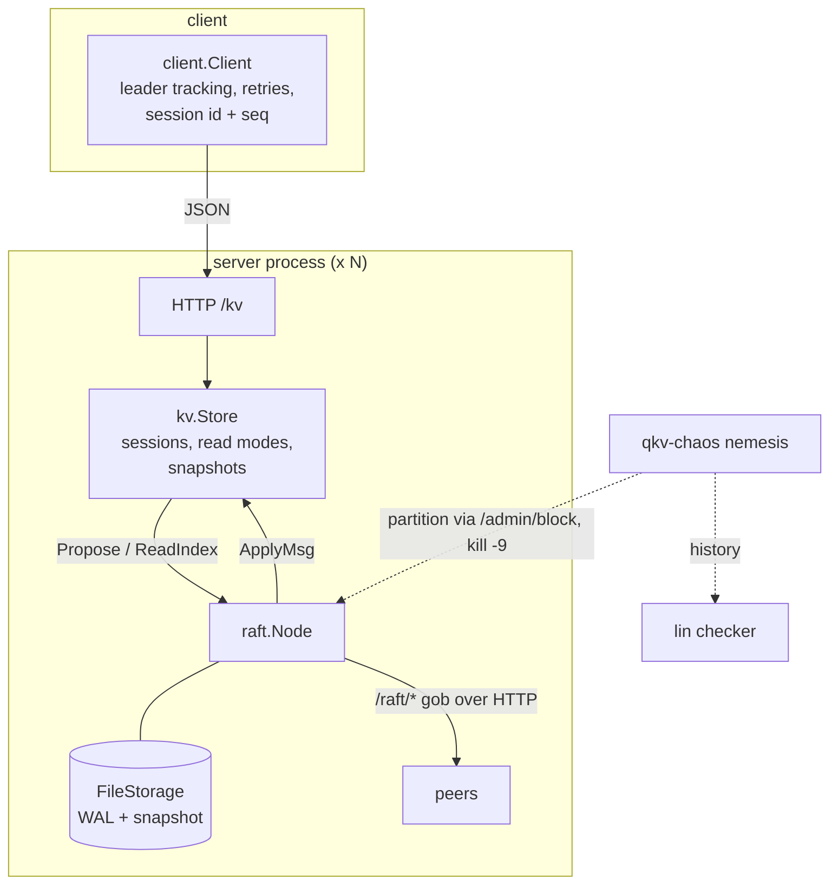

# quorumkv

A Raft-replicated key-value store whose correctness is checked rather than assumed. A bundled linearizability checker validates histories recorded while real server processes are partitioned, `kill -9`'d and restarted.

[](https://github.com/eshaan2418/quorumkv/actions/workflows/ci.yml)
[](LICENSE)


## Why this exists

Raft is short to describe and easy to implement almost correctly. The bugs live in the corners: a deposed leader serving a stale read, a delayed RPC truncating committed entries, a retried write applied twice, a partitioned node inflating its term and knocking out a healthy leader. Most implementations are only tested on the happy path, so these bugs never show up. quorumkv is built the other way around. Every claim in this README comes from a test or a fault-injection run whose history is checked for linearizability, and the checker itself is validated by showing it catches a deliberately unsafe read mode.

## Highlights

- **Linearizability checked under real faults.** `qkv-chaos` runs 5 server processes, partitions them, `kill -9`s leaders and random nodes, restarts them from disk, and checks the full client history with a Wing–Gong/Lowe checker. Clients send each GET to a random server, as a follower-reads load balancer would. Across 10 thirty-second campaigns (5 with ReadIndex reads, 5 with reads through the log), 150,846 operations and 116 injected faults produced zero linearizability violations.
- **The checker catches real bugs.** Run under the same campaign, the intentionally unsafe `-read-mode unsafe-local` (reads served by whatever node you reach) was flagged as non-linearizable in **10 of 10** runs. A deterministic in-process test reproduces the stale read every time.
- **Production Raft details.** PreVote, CheckQuorum, leader stickiness, fast conflict backtracking, snapshots with InstallSnapshot, and ReadIndex reads that need no log write.
- **Crash-safe storage.** A CRC-framed write-ahead log with torn-tail recovery and an atomic snapshot+WAL rewrite. The leader group-commits its fsyncs, and followers fsync outside the node lock, so ReadIndex heartbeats never wait for the disk.
- **Exactly-once writes.** Client sessions with sequence numbers make retries across timeouts and failovers safe. A test drops 20% of messages and checks that every `Append` lands exactly once.
- **Checker validated against Porcupine.** Its verdicts agree with [Porcupine](https://github.com/anishathalye/porcupine) on 2,000 random histories (742 of them non-linearizable).

## Quick start

Requires Go 1.24 or newer.

```sh
git clone https://github.com/eshaan2418/quorumkv && cd quorumkv
make build test        # binaries in ./bin, full test suite with -race
make demo              # 3-node cluster, writes, kill -9 the leader, keep serving
```

## Usage

Run a 3-node cluster:

```sh
C=1=127.0.0.1:7001,2=127.0.0.1:7002,3=127.0.0.1:7003
bin/quorumkv -id 1 -cluster $C -data data/1 &
bin/quorumkv -id 2 -cluster $C -data data/2 &
bin/quorumkv -id 3 -cluster $C -data data/3 &

bin/qkv put user:42 '{"name":"ada"}'
bin/qkv append audit "login;"
bin/qkv get user:42
curl -s 127.0.0.1:7001/status      # role, term, commit/applied index, snapshot index
```

Server flags: `-read-mode index|log|unsafe-local`, `-snapshot-every N`, `-election-timeout`, `-nosync` (benchmarking only), and `-chaos`, which enables `POST /admin/block` for fault injection.

From Go:

```go
c := client.New([]string{"127.0.0.1:7001", "127.0.0.1:7002", "127.0.0.1:7003"}, time.Second)
ctx, cancel := context.WithTimeout(context.Background(), 5*time.Second)
defer cancel()
err := c.Append(ctx, "audit", "login;")    // retried safely until the deadline
v, found, err := c.Get(ctx, "audit")       // linearizable via ReadIndex
```

Fault-injection campaign:

```sh
bin/qkv-chaos -n 5 -clients 10 -duration 30s -seed 3     # prints the fault log and a verdict
make chaos                                               # all read modes, many seeds -> bench/results/chaos/
```

## Architecture



1. **Writes** go through `kv.Store.Do`, which calls `raft.Propose`. The leader appends the entry, writes it to the WAL, and hands it to the per-peer replicators and the flusher. When a majority holds the entry durably, the entry commits and `kv` applies it, deduplicating by session.
2. **Reads** default to ReadIndex. The leader confirms it is still leader with a numbered heartbeat round acknowledged by a majority, waits until it has applied its commit index, and reads locally.
3. **Failures.** Followers that miss heartbeats run PreVote, then an election. A leader cut off from a majority steps down on its own through CheckQuorum. A follower too far behind receives a snapshot.

[docs/DESIGN.md](docs/DESIGN.md) covers the safety arguments, storage format and checker in detail.

## Benchmarks

**Setup:** Apple M5 Pro (18 cores), 48 GB RAM, macOS 27.0.1, Go 1.27.3. All servers and clients run on the same machine over loopback, with `GOMAXPROCS=9` per process. Each load configuration is 5 runs on a fresh cluster (2 s warm-up, then 10 s measured), using 32 closed-loop clients, 128-byte values and 10,000 keys. The table shows the median of the 5 runs. Reproduce with `make bench`. Raw results are in [`bench/results/`](bench/results/).

### Throughput and latency (50% reads unless noted)

| Configuration | ops/s | write p50 | write p99 | read p50 | read p99 |
|---|---:|---:|---:|---:|---:|
| 1 node, fsync | 8,853 | 6.72 ms | 11.99 ms | 0.24 ms | 3.19 ms |
| 3 nodes, fsync | 3,801 | 15.48 ms | 26.91 ms | 0.30 ms | 9.21 ms |
| 5 nodes, fsync | 3,139 | 18.25 ms | 31.27 ms | 0.33 ms | 13.89 ms |
| 3 nodes, no fsync (unsafe) | 70,924 | 0.44 ms | 1.24 ms | 0.35 ms | 1.09 ms |
| 3 nodes, 90% reads, ReadIndex | 16,686 | 14.74 ms | 24.74 ms | 0.24 ms | 6.23 ms |
| 3 nodes, 90% reads, reads in log | 2,037 | 15.68 ms | 25.00 ms | 15.52 ms | 24.84 ms |

### Leader failover

The leader is `kill -9`'d while a probe client writes continuously. The figure is the time from the kill to the next acknowledged write, with a 300 ms base election timeout.

| Cluster | kills | median | min | max |
|---|---:|---:|---:|---:|
| 3 nodes | 10 | 505 ms | 503 ms | 985 ms |
| 5 nodes | 10 | 507 ms | 343 ms | 667 ms |

### Fault-injection campaigns (`make chaos`)

Each run: 5 server processes, 10 clients, 5 keys, 30 s (unsafe control runs: 20 s), with random partitions, `kill -9` of the leader or a random node, and restarts. Clients spread GETs across all servers.

| Read mode | runs | linearizable | ops checked (total) | faults injected (total) |
|---|---:|---:|---:|---:|
| index | 5 | 5/5 | 90,863 | 58 |
| log | 5 | 5/5 | 59,983 | 58 |
| unsafe | 10 | 0/10 | 134,682 | 76 |

### How to read this

- **Writes are bound by fsync.** One WAL append plus `F_FULLFSYNC` takes 3.09 ms on this machine (`bench/results/fsync.txt`). A replicated write waits for the leader's fsync and a follower's fsync in parallel, plus the replication round trip. With fsync disabled, the same 3-node cluster sustains about 18x the throughput, which puts the remaining Raft and HTTP overhead at well under a millisecond.
- **ReadIndex matters.** With 90% reads, ReadIndex delivers 8x the throughput of routing reads through the log. Median read latency is 0.24 ms instead of 15.52 ms, because a read costs one heartbeat round instead of a replicated, fsynced write.
- **Failover takes about 1.7x the election timeout.** Followers must miss heartbeats for a randomized 300–600 ms, run PreVote, and then run the real election. The spread (343–985 ms) comes mostly from that randomization.
- **Limitations:** everything runs on one machine over loopback, so network latency is near zero and clients compete with servers for CPU. Each node uses a single disk. Results on real networks and disks will differ.

## Design decisions and trade-offs

- **ReadIndex rather than leader leases.** Leases avoid even the heartbeat round trip, but they depend on bounded clock drift. ReadIndex depends only on message ordering. The `log` read mode is kept as a baseline: it shows the cost of putting reads in the log.
- **One in-flight AppendEntries per follower.** This is simple and easy to reason about, and batching (up to 1024 entries per RPC) recovers most of the throughput. Pipelining would cut write latency further and is the main item on the roadmap.
- **HTTP and gob between peers.** Easy to debug with `curl`, and good enough while fsync dominates. A custom framed protocol would be faster with `-nosync`.
- **Our own checker, cross-checked against Porcupine.** It keeps the tooling dependency-free, and makes the per-key decomposition and the "pending write" semantics explicit and tested.
- **Panics on storage errors.** A replica that cannot persist must not keep voting or acknowledging. Crashing and restarting from disk is the safe failure mode.

## Testing

| What | Where | How |
|---|---|---|
| Elections, stability, PreVote, CheckQuorum, asymmetric partitions | `raft/cluster_test.go` | in-process cluster on `memnet` (partitions, drops, delays) |
| Log matching, divergent logs, snapshot install, full restart | `raft/cluster_test.go` | every apply is checked for State Machine Safety |
| Randomized crash/partition/unreliable-network chaos | `raft.TestChaos` | 3 seeds × 4 s, 5 nodes |
| Linearizability under faults (ReadIndex and log reads) | `kv.TestLinearizableUnderFaults` | 8 clients, crashes and partitions, history checked |
| The checker catches stale reads | `kv.TestStaleReadIsDetected` | deterministic stale-read scenario |
| Exactly-once under 20% message loss | `kv.TestExactlyOnceAppends` | every append present exactly once |
| WAL torn tail, corruption, snapshot crash windows | `raft/storage_test.go` | byte-level file surgery |
| Checker correctness | `lin/lin_test.go` | agreement with Porcupine on 2,000 histories |
| Real HTTP + disk + restart | `server/server_test.go` | 3 servers, stop the leader, restart from disk |
| Multi-process chaos | `qkv-chaos` (also in CI) | real processes, `kill -9`, partitions |

Everything runs under `go test -race`. CI runs on Linux and macOS and includes a 15-second multi-process chaos smoke test.

## Limitations and roadmap

- Membership is static (no joint consensus or learners).
- No AppendEntries pipelining; writes take about two fsyncs plus a round trip.
- InstallSnapshot sends the whole snapshot in one RPC.
- No TLS or authentication. This is for trusted networks and experiments.
- Roadmap: pipelining, membership changes, chunked snapshots, and a binary peer protocol.

## Project structure

```
raft/               consensus core, WAL storage, cluster tests
kv/                 replicated state machine, sessions, read modes
lin/                linearizability checker
server/  client/    HTTP server and Go client
transport/memnet/   fault-injecting in-memory network for tests
internal/launch/    runs real multi-process clusters
cmd/                quorumkv (server), qkv (CLI), qkv-chaos, qkv-bench
bench/results/      raw benchmark and chaos outputs
docs/DESIGN.md      design notes
```

## License

MIT. See [LICENSE](LICENSE).
